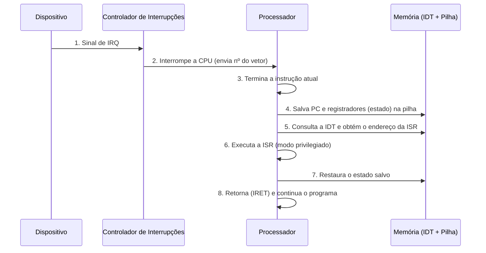
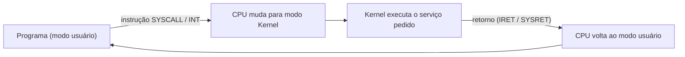

# Mecanismos de Interrupção e Exceção

> **Disciplina:** Arquitetura e Organização de Computadores
> **Professor:** George Mendes Marra

## Objetivos de aprendizagem

Ao final deste material, você será capaz de:

- Diferenciar **interrupção**, **exceção** e **chamada de sistema**.
- Descrever, passo a passo, como o processador atende uma interrupção.
- Explicar o papel do **vetor de interrupções** e da **ISR**.
- Comparar **polling**, **interrupção** e **DMA**.
- Relacionar esses mecanismos com **desempenho**, **sistemas operacionais** e **cibersegurança**.

---

## 1. Por que as interrupções existem?

O processador executa instruções em sequência (ciclo **busca → decodificação → execução**). Mas o mundo real é imprevisível: o usuário aperta uma tecla, um pacote chega pela rede, um disco termina uma leitura.

Existem duas formas de o processador saber que algo aconteceu:

| Técnica | Como funciona | Problema / vantagem |
|---|---|---|
| **Polling** (varredura) | A CPU pergunta repetidamente ao dispositivo: "terminou?" | Desperdiça ciclos de CPU (*busy waiting*) |
| **Interrupção** | O dispositivo avisa a CPU quando precisa de atenção | A CPU trabalha em outra coisa até ser avisada |
| **DMA** (*Direct Memory Access*) | Um controlador transfere dados entre dispositivo e memória sem a CPU; ao final, gera **uma** interrupção | Ideal para grandes volumes de dados (disco, rede) |

> **Analogia:** polling é ficar abrindo a porta a cada minuto para ver se o entregador chegou. Interrupção é ouvir a campainha.

---

## 2. Classificação geral

Existem três situações que desviam o fluxo normal de execução:

| Tipo | Origem | Síncrona ou assíncrona? | Exemplos |
|---|---|---|---|
| **Interrupção (hardware)** | Dispositivo externo | **Assíncrona** (pode ocorrer a qualquer momento) | Teclado, placa de rede, timer, disco |
| **Exceção** | Dentro da própria CPU, causada pela instrução em execução | **Síncrona** (ligada a uma instrução específica) | Divisão por zero, *page fault*, instrução inválida |
| **Interrupção de software / System Call** | Instrução intencional do programa | **Síncrona** | `INT 0x80`, `SYSCALL`, `SVC` (ARM) |

> **Atenção:** é comum chamar exceções de "interrupções de software", mas o termo mais preciso é **exceção**, pois ela é gerada **pelo próprio processador** ao executar uma instrução, e não por um programa que "decide" gerá-la. Já a chamada de sistema é, essa sim, uma solicitação intencional do programa ao Kernel.

---

## 3. Interrupção de hardware

Uma interrupção é um **sinal elétrico** enviado ao processador por um dispositivo indicando que um evento precisa de atenção.

### 3.1 Componentes envolvidos

- **IRQ** (*Interrupt Request*): a linha/sinal que o dispositivo usa para pedir atenção.
- **Controlador de interrupções** (PIC / APIC): recebe as IRQs de vários dispositivos, aplica prioridades e entrega uma por vez à CPU.
- **ISR** (*Interrupt Service Routine*), também chamada de **Tratador de Interrupção** (*Interrupt Handler*): a rotina que trata o evento.
- **Vetor de interrupções** (IVT / IDT): tabela na memória que associa cada número de interrupção ao endereço da sua ISR.

### 3.2 Ciclo de atendimento de uma interrupção



**Resumo em palavras:**

1. O dispositivo ativa sua linha de IRQ.
2. O controlador avisa o processador.
3. A CPU **conclui a instrução em andamento** (ela não é cortada no meio).
4. O estado atual (contador de programa, registrador de flags, etc.) é **salvo na pilha**.
5. A CPU usa o número da interrupção como **índice no vetor** e descobre o endereço da ISR.
6. A **ISR** executa e trata o evento (ex.: ler o código da tecla pressionada).
7. O estado é restaurado e a execução **retoma exatamente de onde parou**, de forma transparente ao programa interrompido.

### 3.3 Prioridade e mascaramento

- **Prioridade:** quando duas interrupções chegam juntas, atende-se primeiro a mais importante (ex.: falha de energia > teclado).
- **Mascaramento:** a CPU pode **ignorar temporariamente** certas interrupções (instruções como `CLI`/`STI` no x86) durante trechos críticos do código do Kernel.
- **NMI** (*Non-Maskable Interrupt*): interrupção **não mascarável**, reservada para eventos gravíssimos (erro de memória, falha de hardware), pois não pode ser ignorada.

### 3.4 Exemplos comuns

- Pressionar uma tecla no teclado.
- Chegada de dados pela placa de rede (essencial para o **Back-End** receber requisições).
- Sinal do **temporizador (timer)**, que permite ao sistema operacional alternar entre processos (*preempção* e *escalonamento*).
- Conclusão de uma operação de disco (via DMA).

---

## 4. Exceções

Exceções são eventos gerados **pelo próprio processador** quando a execução de uma instrução causa um erro ou uma condição especial.

### 4.1 Tipos de exceção

| Tipo | Retoma em qual instrução? | Gravidade | Exemplos |
|---|---|---|---|
| **Falta (*Fault*)** | Na **mesma** instrução que causou o problema (após correção) | Corrigível | *Page Fault* (página não está na RAM), divisão por zero (no x86) |
| **Trapa (*Trap*)** | Na **próxima** instrução | Geralmente intencional | *Breakpoint* de depurador, instrução de chamada de sistema |
| **Aborto (*Abort*)** | Não retoma | Grave e irrecuperável | Falha de hardware, erro de paridade de memória (*machine check*) |

### 4.2 Exemplo: o *Page Fault* passo a passo

1. O programa acessa um endereço virtual cuja página **não está na RAM**.
2. A CPU gera uma exceção (*fault*).
3. O Kernel trata: localiza a página no disco e a carrega na memória.
4. A mesma instrução é **reexecutada** e, agora, funciona.

Se o endereço for **inválido** (não pertence ao processo), o Kernel não consegue corrigir e encerra o programa, o famoso **Segmentation Fault** (*segfault*).

### 4.3 Exceções, `try/catch` e linguagens de alto nível

Cuidado para não confundir: a **exceção de hardware** (ex.: divisão por zero na CPU) é diferente da **exceção de linguagem** (ex.: `ArithmeticException` em Java). A JVM (ou o sistema operacional) pode **converter** a exceção de hardware em uma exceção que o programador consegue tratar com `try/catch`.

---

## 5. Chamadas de sistema (*System Calls*)

Programas comuns rodam em **modo usuário**, sem acesso direto ao hardware. Para ler um arquivo, abrir um socket ou alocar memória, precisam pedir ao Kernel.



Esse é o **mecanismo de transição controlada** entre os dois modos de operação: o programa não escolhe onde o Kernel começa a executar; quem decide é a tabela de vetores.

---

## 6. Interrupções no dia a dia: o caminho de um pacote de rede

Para um servidor Back-End (por exemplo, uma aplicação Spring Boot), cada requisição HTTP passa por interrupções:

1. O pacote chega à **placa de rede**.
2. A placa grava os dados na memória (**DMA**) e gera uma **interrupção**.
3. A **ISR** do driver reconhece o evento e agenda o processamento do restante.
4. O Kernel entrega os dados ao **socket** da aplicação.
5. A aplicação, que estava bloqueada esperando, é **acordada** pelo escalonador.

> Em redes de alto tráfego, o Linux usa o **NAPI**, que alterna entre interrupção e polling para evitar sobrecarga quando chegam milhares de pacotes por segundo.

---

## 7. Relação direta com a Cibersegurança

### 7.1 Proteção de memória (Integridade)

Se um programa tenta acessar uma área de memória proibida (comum em tentativas de invasão, como *buffer overflow*), o processador gera uma **exceção de violação de acesso** (*protection fault*). O Kernel então interrompe o processo, protegendo a **Integridade** do sistema.

Mecanismos que dependem de exceções:

- **Separação modo usuário / modo Kernel** (anéis de proteção).
- **Bit NX / DEP**: marcar regiões de dados como não executáveis; tentar executá-las gera exceção.
- **Canários de pilha e ASLR**: dificultam a exploração e frequentemente resultam em falha controlada.

> **Importante:** esses mecanismos **reduzem** a superfície de ataque, mas não eliminam todos os ataques. Técnicas como *ROP* (*Return-Oriented Programming*) tentam contorná-los.

### 7.2 Negação de serviço (Disponibilidade)

Um excesso proposital de interrupções (*interrupt storm*), como em um ataque de **Negação de Serviço (DoS)**, pode sobrecarregar o processador. A CPU passa a maior parte do tempo atendendo ISRs e não consegue executar o ciclo normal de instruções, afetando a **Disponibilidade**.

**Contramedidas comuns:**

- *Interrupt coalescing* (agrupar várias interrupções em uma só).
- NAPI / polling adaptativo.
- Limitação de taxa (*rate limiting*) e filtros no firewall.

### 7.3 Ataques à tabela de vetores (Integridade)

Um *rootkit* pode tentar **sobrescrever entradas** da tabela de interrupções ou da tabela de chamadas de sistema para redirecionar o fluxo a código malicioso (*hooking*). Por isso sistemas modernos protegem essas tabelas (ex.: *PatchGuard* no Windows, páginas somente leitura no Linux).

---

## 8. Observando interrupções na prática (Linux)

Veja quantas interrupções cada dispositivo gerou desde o boot:

```bash
cat /proc/interrupts
```

Veja as chamadas de sistema que um programa realiza:

```bash
strace -c ls
```

Acompanhe mensagens do Kernel (incluindo falhas e exceções):

```bash
dmesg | tail
```

**Atividade sugerida:** execute `cat /proc/interrupts` duas vezes, com alguns segundos de intervalo, movendo o mouse ou digitando entre as leituras. Quais contadores aumentaram? Por quê?

---

## 9. Resumo comparativo

| Característica | Interrupção | Exceção | System Call |
|---|---|---|---|
| **Gerada por** | Dispositivo externo | Instrução com erro/condição especial | Instrução intencional do programa |
| **Momento** | Assíncrona | Síncrona | Síncrona |
| **Previsível?** | Não | Depende da instrução | Sim |
| **Exemplo** | Tecla pressionada | Page fault | `read()`, `write()` |

---

## 10. Exercícios

1. Qual a diferença entre **polling** e **interrupção**? Em que situação o polling pode ser preferível?
2. Por que a CPU precisa **salvar o estado** antes de executar uma ISR?
3. Qual a diferença entre uma **falta (*fault*)** e uma **trapa (*trap*)** quanto ao ponto de retorno?
4. Por que uma divisão por zero em Java gera `ArithmeticException`, se o evento original acontece no hardware?
5. Explique como um ataque de **negação de serviço** pode explorar o mecanismo de interrupções.
6. Qual a função do **bit NX** e que exceção ele pode gerar?
7. *(Desafio)* Por que o *timer* é indispensável para um sistema operacional multitarefa?

---

## 11. Referências sugeridas

- TANENBAUM, A. S.; AUSTIN, T. **Organização Estruturada de Computadores**. Pearson.
- STALLINGS, W. **Arquitetura e Organização de Computadores**. Pearson.
- PATTERSON, D. A.; HENNESSY, J. L. **Organização e Projeto de Computadores**. Elsevier.
- TANENBAUM, A. S.; BOS, H. **Sistemas Operacionais Modernos**. Pearson.
