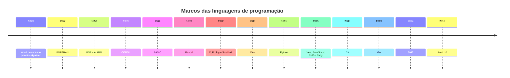
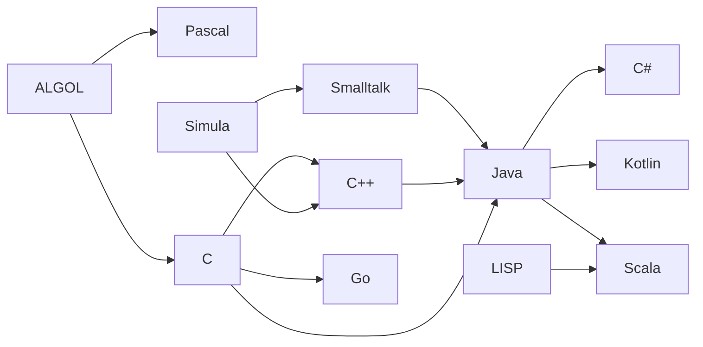

# 📜 Breve Histórico das Linguagens de Programação

A história das linguagens de programação acompanha a própria evolução da computação. Cada linguagem nasceu para resolver um problema concreto: calcular mais rápido, tornar o código mais legível, organizar sistemas grandes, rodar na web ou em um celular. Entender essa trajetória ajuda a compreender **por que** as linguagens são como são hoje.

## 📑 Sumário

1. [Linha do tempo](#-linha-do-tempo)
2. [Primórdios e pioneiros](#-primórdios-e-pioneiros-século-xix--década-de-1940)
3. [Décadas de 1950 e 1960](#-décadas-de-1950-e-1960-as-primeiras-linguagens-de-alto-nível)
4. [Década de 1970](#-década-de-1970-programação-estruturada-e-novos-paradigmas)
5. [Décadas de 1980 e 1990](#-décadas-de-1980-e-1990-orientação-a-objetos-e-a-era-da-internet)
6. [Século XXI](#-século-xxi-diversidade-e-especialização)
7. [Gerações das linguagens](#-gerações-das-linguagens-de-programação)
8. [Paradigmas de programação](#-paradigmas-de-programação)
9. [Quadro-resumo](#-quadro-resumo)
10. [Como as linguagens se influenciam](#-como-as-linguagens-se-influenciam)
11. [Para refletir e praticar](#-para-refletir-e-praticar)
12. [Referências](#-referências)

---

## 🕰️ Linha do tempo

---

## 🌟 Primórdios e pioneiros (século XIX – década de 1940)

- **1843 – Ada Lovelace:** ao traduzir um artigo sobre a **Máquina Analítica** de Charles Babbage, acrescentou notas que incluíam um algoritmo para calcular números de Bernoulli. Por isso é frequentemente chamada de **primeira programadora**. A máquina nunca foi construída por completo, então o algoritmo não chegou a ser executado na época.
- **1942–1945 – Konrad Zuse e o Plankalkül:** considerada a **primeira linguagem de programação de alto nível** concebida. Ficou praticamente desconhecida por décadas e só foi publicada em 1972, com implementação muito posterior.
- **Código de máquina:** os primeiros computadores eram programados diretamente em **sequências binárias** (zeros e uns), um processo lento e sujeito a erros.
- **Linguagem Assembly (final dos anos 1940):** substituiu os números por **mnemônicos** (como `MOV` e `ADD`), facilitando a leitura. Ainda é específica para cada arquitetura de processador.

> 💡 **Curiosidade:** em 1952, **Grace Hopper** criou o **A-0**, considerado um dos primeiros **compiladores**, que traduzia uma notação simbólica em código de máquina.

---

## 🚀 Décadas de 1950 e 1960: as primeiras linguagens de alto nível

Nessa época surgiram as primeiras linguagens de alto nível de uso difundido, que permitiam escrever programas sem depender do hardware específico.

- **FORTRAN (1957):** criada por uma equipe da IBM liderada por **John Backus** (o projeto começou em 1954). Seu nome vem de *FORmula TRANslator*. Foi a primeira linguagem de alto nível amplamente usada e é focada em cálculo científico. Ainda é usada em computação de alto desempenho.
- **LISP (1958):** criada por **John McCarthy**, voltada ao processamento de listas e à manipulação simbólica. Foi central nas primeiras pesquisas de **Inteligência Artificial** e introduziu ideias como a coleta de lixo (*garbage collection*).
- **ALGOL (1958/1960):** desenvolvida por um comitê internacional, introduziu **blocos de código** e a **programação estruturada**. Influenciou quase todas as linguagens posteriores, incluindo Pascal, C e Java.
- **COBOL (1959):** desenvolvida com forte influência de **Grace Hopper**, voltada a aplicações comerciais (*COmmon Business Oriented Language*). Bancos e governos ainda mantêm sistemas COBOL em produção.
- **Simula (1967):** criada na Noruega por **Ole-Johan Dahl** e **Kristen Nygaard**, introduziu os conceitos de **classes e objetos**. É considerada a **primeira linguagem orientada a objetos**.
- **BASIC (1964):** criada por John Kemeny e Thomas Kurtz no Dartmouth College para tornar a programação acessível a estudantes de qualquer área.

---

## 💻 Década de 1970: programação estruturada e novos paradigmas

- **Pascal (1970):** criada por **Niklaus Wirth** com foco no **ensino da programação estruturada**. Foi muito usada em universidades.
- **C (1972):** criada por **Dennis Ritchie** nos Bell Labs. Combina **alto desempenho** com acesso de baixo nível à memória e foi usada para reescrever o **Unix**. É a base de linguagens como C++, Java, C# e Go.
- **Prolog (1972):** criada por Alain Colmerauer e colaboradores, é uma das primeiras linguagens do **paradigma lógico**.
- **Smalltalk (1972):** desenvolvida por **Alan Kay** e equipe no Xerox PARC, consolidou e popularizou a **orientação a objetos** pura.
- **SQL (década de 1970):** desenvolvida na IBM para consulta e manipulação de **bancos de dados relacionais**, é usada até hoje.

---

## 🌐 Décadas de 1980 e 1990: orientação a objetos e a era da Internet

### Década de 1980

- **C++ (1983):** criada por **Bjarne Stroustrup** como extensão do C, adicionando classes e outros recursos de **orientação a objetos** sem perder desempenho.
- **Ada (1980):** desenvolvida para o Departamento de Defesa dos EUA, voltada a sistemas críticos e de alta confiabilidade.
- **Perl (1987):** criada por Larry Wall, muito usada para manipulação de texto e administração de sistemas.

### Década de 1990

- **Python (1991):** criada por **Guido van Rossum**, com foco em **legibilidade** e produtividade.
- **Java (1995):** desenvolvida na Sun Microsystems por uma equipe liderada por **James Gosling**. Seu lema era *"Write Once, Run Anywhere"* (WORA), graças à **máquina virtual Java (JVM)**. Tornou-se fundamental em sistemas corporativos e aplicações web.
- **JavaScript (1995):** criada por **Brendan Eich** na Netscape para tornar as páginas web **dinâmicas** no navegador. Hoje também roda no servidor (Node.js).
- **PHP (1995):** criada por Rasmus Lerdorf, tornou-se uma das linguagens mais usadas no desenvolvimento **backend** web.
- **Ruby (1995):** criada por Yukihiro Matsumoto, com foco na felicidade e produtividade do programador. Ficou famosa com o framework Rails.

> 💡 **Curiosidade:** a primeira versão do JavaScript foi criada em apenas **10 dias**, e apesar do nome **não tem relação direta com Java**.

---

## 📱 Século XXI: diversidade e especialização

As linguagens atuais se diversificam para atender a áreas específicas, como web, mobile, ciência de dados, sistemas e nuvem.

| Ano | Linguagem | Criador / Origem | Foco principal |
|:---:|-----------|------------------|----------------|
| 2000 | **C#** | Microsoft (Anders Hejlsberg) | Plataforma .NET, aplicações corporativas e jogos (Unity) |
| 2004 | **Scala** | Martin Odersky | Mistura de orientação a objetos e programação funcional na JVM |
| 2009 | **Go** | Google | Desempenho, concorrência e serviços em nuvem |
| 2010 | **Rust** | Mozilla (Graydon Hoare) | Segurança de memória sem coletor de lixo (versão 1.0 em 2015) |
| 2011 | **Kotlin** | JetBrains | Interoperável com Java; adotada pelo Google como linguagem preferencial para Android em 2019 |
| 2012 | **TypeScript** | Microsoft | Extensão do JavaScript com **tipagem estática** |
| 2012 | **Julia** | Bezanson, Karpinski e outros | Computação científica de alto desempenho |
| 2014 | **Swift** | Apple | Desenvolvimento para iOS e macOS |

Outras linguagens importantes nesse cenário:

- **R:** criada em 1993, voltada a **estatística e ciência de dados**.
- **Python:** popularizou-se em **ciência de dados, automação e Inteligência Artificial**, graças a bibliotecas como NumPy, pandas e frameworks de aprendizado de máquina.
- **Java:** continua sendo uma das linguagens mais usadas em sistemas corporativos, back-end e Android, com ecossistema como o **Spring**.

Essa evolução reflete a busca contínua por código mais **legível, seguro e eficiente**, adaptado às mudanças de hardware (multicore, nuvem, dispositivos móveis) e de software.

---

## 🧬 Gerações das linguagens de programação

| Geração | Nome | Exemplos | Características |
|:-------:|------|----------|-----------------|
| 1ª | Linguagem de máquina | Código binário | Instruções diretas para o processador, sem tradução |
| 2ª | Linguagem de montagem | Assembly | Mnemônicos; dependente da arquitetura |
| 3ª | Alto nível | FORTRAN, C, Java, Python | Próxima da linguagem humana; independente de hardware |
| 4ª | Linguagens de domínio específico | SQL e geradores de relatórios | Descrevem **o que** se quer, não **como** fazer |
| 5ª | Baseadas em restrições e lógica | Prolog | Voltadas à resolução de problemas e à IA simbólica |

> ℹ️ Essa classificação é didática e as fronteiras entre as gerações, principalmente da 4ª e da 5ª, variam conforme o autor.

---

## 🧩 Paradigmas de programação

Um **paradigma** é um estilo de organizar e pensar o código. Muitas linguagens modernas são **multiparadigma**.

| Paradigma | Ideia central | Exemplos |
|-----------|---------------|----------|
| **Imperativo / procedural** | Sequência de comandos que alteram o estado do programa | C, Pascal, FORTRAN |
| **Estruturado** | Uso de sequência, decisão e repetição, sem `goto` desordenado | ALGOL, Pascal, C |
| **Orientado a objetos** | Programas organizados em objetos que combinam dados e comportamento | Smalltalk, Java, C++, C# |
| **Funcional** | Funções como elementos centrais, evitando estado mutável | LISP, Haskell, Scala |
| **Lógico** | Programas descritos por fatos e regras | Prolog |
| **Concorrente / paralelo** | Várias tarefas executando ao mesmo tempo | Go, Erlang, Rust |

---

## 📊 Quadro-resumo

| Ano | Linguagem | Criador | Principal contribuição |
|:---:|-----------|---------|------------------------|
| 1843 | (Algoritmo de Ada) | Ada Lovelace | Primeiro algoritmo para uma máquina de computar |
| 1945 | Plankalkül | Konrad Zuse | Primeira linguagem de alto nível concebida |
| 1957 | FORTRAN | John Backus | Cálculo científico |
| 1958 | LISP | John McCarthy | IA e programação funcional |
| 1958 | ALGOL | Comitê internacional | Programação estruturada |
| 1959 | COBOL | Grace Hopper (influência) | Aplicações comerciais |
| 1967 | Simula | Dahl e Nygaard | Classes e objetos |
| 1970 | Pascal | Niklaus Wirth | Ensino de programação estruturada |
| 1972 | C | Dennis Ritchie | Sistemas operacionais e alto desempenho |
| 1983 | C++ | Bjarne Stroustrup | Orientação a objetos com desempenho |
| 1991 | Python | Guido van Rossum | Legibilidade e produtividade |
| 1995 | Java | James Gosling | Portabilidade (WORA) |
| 1995 | JavaScript | Brendan Eich | Web dinâmica |
| 2000 | C# | Anders Hejlsberg | Plataforma .NET |
| 2009 | Go | Google | Concorrência e nuvem |
| 2014 | Swift | Apple | Desenvolvimento Apple |

---

## 🔗 Como as linguagens se influenciam

> 💡 As setas indicam **influência de projeto**, não relação de código. Várias dessas linguagens receberam influências de muitas outras.

---

## ✍️ Para refletir e praticar

1. Por que o **COBOL** e o **FORTRAN**, criados há mais de 60 anos, ainda são usados?
2. Qual a diferença entre uma linguagem **compilada** (C), **interpretada** (Python) e que roda sobre **máquina virtual** (Java)?
3. Por que o Java adotou o lema **WORA**? Que problema ele resolvia?
4. Escolha duas linguagens da linha do tempo e explique **qual problema** cada uma buscava resolver.
5. Pesquise o **ranking atual** de popularidade de linguagens (por exemplo, TIOBE ou Stack Overflow Developer Survey) e compare com a linha do tempo deste material.
6. Escreva o programa "Olá, mundo!" em três linguagens diferentes e compare a sintaxe.

---

## 📚 Referências

- SEBESTA, Robert W. **Conceitos de Linguagens de Programação**. Bookman.
- SCOTT, Michael L. **Programming Language Pragmatics**. Morgan Kaufmann.
- BERGIN, Thomas J.; GIBSON, Richard G. (orgs.). **History of Programming Languages II**. ACM Press.
- Computer History Museum: <https://computerhistory.org>
- TIOBE Index: <https://www.tiobe.com/tiobe-index/>

---

📌 **Material didático** – Professor George Mendes Marra
