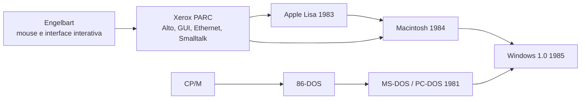

# Análise tecnológica — *Os Piratas do Vale do Silício*

> Material didático — Teoria da Computação · Análise fílmica
> Prof. George Mendes Marra · UniAlfa

---

## Ficha do filme

| Item | Informação |
| --- | --- |
| Título original | *Pirates of Silicon Valley* |
| Ano | 1999 |
| Direção | Martyn Burke |
| Produção | TNT (filme para TV) |
| Base | Livro *Fire in the Valley* (Paul Freiberger e Michael Swaine, 1984) |
| Elenco principal | Noah Wyle (Steve Jobs), Anthony Michael Hall (Bill Gates), Joey Slotnick (Steve Wozniak) |
| Período retratado | 1971 a 1997 |
| Duração | cerca de 95 a 100 minutos |

---

## 1. Objetivo desta análise

Diferente de uma análise fílmica tradicional (roteiro, direção, temas e personagens), esta análise observa *Os Piratas do Vale do Silício* como **registro dramatizado de marcos técnicos da computação**: quais tecnologias aparecem, em que contexto histórico, qual a sua importância para a ciência da computação e o quanto o filme é tecnicamente preciso ao retratá-las.

O filme funciona como um panorama da transição do computador de **hobby de laboratório e garagem** para **produto de consumo em massa**.

**Como ler este documento.** Cada marco tecnológico (seção 3) é organizado em quatro blocos:

- **No filme:** o que a obra mostra;
- **Na história real:** o que de fato aconteceu;
- **Relevância técnica:** por que o marco importa para a computação;
- **Precisão:** o quanto a dramatização se aproxima dos fatos.

---

## 2. Linha do tempo tecnológica

| Ano | Marco | Quem |
| --- | --- | --- |
| 1964–1968 | Mouse e interface interativa demonstrados (a "mãe de todas as demos") | Douglas Engelbart |
| 1971–1972 | Caixas azuis (*blue boxes*) vendidas a estudantes | Wozniak e Jobs |
| 1973 | Xerox Alto: GUI com tela *bitmap*, mouse e Ethernet | Xerox PARC |
| 1975 | Altair 8800 e Altair BASIC; fundação da Microsoft | MITS, Gates e Allen |
| 1975 | Homebrew Computer Club | Hobbistas da região de Palo Alto |
| 1976 | Apple I | Wozniak e Jobs |
| 1977 | Apple II | Wozniak e Jobs |
| 1979 | Visita de Jobs e equipe ao Xerox PARC | Apple e Xerox |
| 1980–1981 | 86-DOS vira MS-DOS / PC-DOS | Paterson, Microsoft, IBM |
| 1981 | IBM PC (modelo 5150) | IBM |
| 1983 | Apple Lisa | Apple |
| 1984 | Macintosh | Apple |
| 1985 | Windows 1.0 | Microsoft |
| 1988–1994 | Processo Apple x Microsoft sobre a interface gráfica | Apple e Microsoft |
| 1997 | Investimento da Microsoft na Apple (US$ 150 milhões) | Gates e Jobs |

---

## 3. Marcos tecnológicos retratados

### 3.1 Caixas azuis (*blue boxes*) — *phreaking* telefônico

**No filme:** Jobs e Wozniak vendem dispositivos que geram tons de frequência capazes de enganar a rede telefônica analógica e permitir ligações interurbanas sem custo.

**Na história real:** a rede da AT&T usava **sinalização em banda**: os tons de controle (como o de 2600 Hz, que indicava uma linha tronco livre) trafegavam no mesmo canal da voz. Quem conseguisse reproduzir esses tons (os *phreakers*, como John Draper, o "Captain Crunch") conseguia comandar o roteamento das chamadas. Wozniak construiu uma versão digital do aparelho.

**Relevância técnica:** é o exemplo clássico de falha de projeto em que **o canal de dados e o canal de controle são o mesmo**. A solução da indústria foi a **sinalização fora de banda** (separar o controle da voz), princípio que reaparece em segurança da informação (por exemplo, na separação entre plano de dados e plano de controle em redes). Para os dois jovens, foi também um exercício de **engenharia reversa** de um protocolo.

**Precisão:** o filme é fiel ao espírito do episódio, sem detalhar o funcionamento técnico.

### 3.2 Altair 8800 e o BASIC da Microsoft

**No filme:** o Altair 8800 desperta o interesse de Gates e Allen, que escrevem um interpretador **BASIC** para o processador Intel 8080, o primeiro produto da Microsoft.

**Na história real:** o Altair (MITS, 1975) foi capa da revista *Popular Electronics* e é considerado o marco do computador pessoal comercial. Vinha em kit, sem teclado nem monitor, e era programado por chaves e luzes no painel. Gates e Allen escreveram o BASIC **sem ter a máquina em mãos**, usando um emulador do 8080 rodando em um computador de grande porte (PDP-10) em Harvard.

**Relevância técnica:**

- um **interpretador** em uma máquina com pouquíssima memória exige técnicas de economia de espaço, como a representação compacta do programa em *tokens*;
- uma linguagem de alto nível transformou uma placa de hobby em uma máquina **programável por qualquer pessoa**;
- o episódio é um bom caso de **desenvolvimento por emulação**, prática comum até hoje.

**Contexto:** em 1976, Gates publicou a "Carta Aberta aos Hobbistas", reclamando da cópia não autorizada do BASIC. O choque entre compartilhar e vender software é um dos fios condutores do filme, e o título dialoga com essa ideia de "pirataria".

**Precisão:** boa, com a simplificação natural de condensar meses de trabalho em poucas cenas.

### 3.3 Homebrew Computer Club

**No filme:** o clube de hobbistas onde entusiastas trocavam esquemas de hardware livremente.

**Na história real:** o clube surgiu em 1975 na região de Menlo Park e Palo Alto (Califórnia). Wozniak apresentou ali os primeiros projetos que levariam ao Apple I.

**Relevância técnica:** representa um modelo de desenvolvimento **aberto e colaborativo**, anterior à lógica de propriedade intelectual fechada que passaria a dominar a indústria. É um antecedente cultural do software livre, tema tratado em outros filmes desta série de análises (como *Revolution OS*).

### 3.4 Apple I e Apple II

**No filme:** a construção do Apple I na garagem da família Jobs e, em seguida, o Apple II, já com gabinete plástico, teclado integrado e cores.

**Na história real:**

- o **Apple I** (1976) era uma placa montada com processador MOS 6502, vendida sem gabinete, teclado ou monitor;
- o **Apple II** (1977) trazia BASIC em ROM, gráficos coloridos, teclado integrado e **slots de expansão**; o projeto eletrônico, muito econômico em componentes, é atribuído a Wozniak, e o gabinete e o conceito de produto, a Jobs;
- o leitor de disquete (1978) e a planilha VisiCalc (1979) transformaram o Apple II em ferramenta de trabalho.

**Relevância técnica:** a ideia de **computador "pronto para usar"** (em vez de kit) e a **arquitetura aberta por slots**, que permitiu um ecossistema de periféricos e de software.

**Precisão:** boa quanto à divisão de papéis, embora o filme dê pouco espaço ao papel do VisiCalc.

### 3.5 MS-DOS e o contrato com a IBM

**No filme:** a Microsoft, sem um sistema operacional próprio pronto, negocia a compra de um sistema já existente para entregá-lo à IBM.

**Na história real:** a Microsoft licenciou (dezembro de 1980) e depois comprou (1981) os direitos do **86-DOS**, também chamado **QDOS** (*Quick and Dirty Operating System*), criado por **Tim Paterson** na Seattle Computer Products. O sistema foi adaptado e entregue à IBM como **PC-DOS** para o IBM PC (1981), e a Microsoft manteve o direito de vendê-lo a outros fabricantes como **MS-DOS**. A IBM havia procurado antes a Digital Research, de Gary Kildall, criador do CP/M, sistema que influenciou a interface de programação do 86-DOS.

**Relevância técnica:** ilustra que **não é preciso criar a tecnologia do zero para dominar um mercado**: o controle do licenciamento e da distribuição pode pesar mais que a autoria do código.

**Curiosidade para a disciplina:** o código-fonte de versões antigas do MS-DOS (1.25 e 2.0) foi liberado pela própria Microsoft em repositório público no GitHub (`microsoft/MS-DOS`), o que permite estudar um sistema operacional real e pequeno.

**Precisão:** o filme acerta o resultado e simplifica o processo contratual real.

### 3.6 IBM PC e arquitetura aberta

**No filme:** a IBM decide entrar no mercado de computadores pessoais e licencia o MS-DOS de forma **não exclusiva**.

**Na história real:** a equipe da IBM montou o PC 5150 com **componentes comerciais de prateleira** (processador Intel 8088, entre outros) para chegar rápido ao mercado. A IBM, porém, mantinha a **BIOS** como código proprietário. Os "clones" só se tornaram viáveis quando empresas como a Compaq (1982–1983) reescreveram a BIOS por **engenharia reversa de sala limpa** (*clean room*), sem copiar o código original.

**Relevância técnica:** a combinação de **arquitetura aberta + MS-DOS licenciável + BIOS clonada legalmente** criou o padrão "IBM PC compatível", consolidou a **arquitetura x86** e, paradoxalmente, favoreceu a Microsoft (e o processador da Intel) muito mais que a própria IBM.

**Precisão:** o filme destaca bem a decisão de licenciamento, mas o papel da BIOS e dos clones fica fora do recorte.

### 3.7 Xerox PARC — interface gráfica, mouse e rede local

**No filme:** a visita de Jobs e equipe ao **Xerox PARC**, onde eles conhecem uma interface gráfica com janelas, ícones e menus, o mouse e conceitos de rede local.

**Na história real:** o PARC desenvolveu o **Xerox Alto** (1973), com tela *bitmap*, mouse e interface gráfica, além de:

- **Ethernet** (Bob Metcalfe);
- a linguagem **Smalltalk** e a programação orientada a objetos (Alan Kay e equipe);
- a **impressora a laser** (Gary Starkweather);
- editores de texto do tipo WYSIWYG (Charles Simonyi, que depois foi trabalhar na Microsoft).

A Xerox chegou a lançar um produto comercial com GUI, o **Xerox Star** (1981), mas caro e sem sucesso de mercado. Segundo relatos amplamente citados, a Xerox também investiu na Apple antes de sua abertura de capital, o que contextualiza o acesso da equipe de Jobs ao laboratório.

**Relevância técnica:** o mouse é anterior (**Douglas Engelbart**, década de 1960). O PARC **refinou e integrou** ideias em um sistema coerente; a Apple as **reinterpretou** para um produto de custo viável (por exemplo, o mouse de um botão e a barra de menus fixa no topo).

**Precisão:** o filme concentra em um único momento de "revelação" um processo que envolveu meses de trabalho da equipe de engenharia da Apple.

### 3.8 Lisa e Macintosh

**No filme:** o desenvolvimento do Macintosh como resposta ao contato com o PARC, um computador totalmente gráfico operado por mouse, lançado em 1984.

**Na história real:** a Apple lançou antes o **Lisa** (1983), com GUI, mas caro e lento. O **Macintosh** (1984) usava o processador Motorola 68000 e tinha 128 KB de memória, tela monocromática de 9 polegadas e disquete de 3,5". Sua equipe incluía nomes como **Andy Hertzfeld** (software de sistema), **Bill Atkinson** (QuickDraw, MacPaint) e **Burrell Smith** (projeto de hardware). O projeto foi iniciado por **Jef Raskin**.

**Relevância técnica:** o Macintosh popularizou, sem inventar, o paradigma **WIMP** (*Windows, Icons, Menus, Pointer*), mostrando que a GUI cabia em um produto de consumo e dependia de **otimização severa de software** (rotinas gráficas em ROM, por exemplo).

**Precisão:** o filme omite o Lisa, que foi o primeiro passo real da Apple nesse caminho.

### 3.9 Microsoft Windows e a disputa pela interface

**No filme:** a Microsoft desenvolve sua própria interface gráfica sobre o MS-DOS, e Jobs acusa Gates de ter "roubado" a interface do Macintosh.

**Na história real:** o Windows foi anunciado em 1983 e lançado em 1985 (versão 1.0, com janelas lado a lado, não sobrepostas). A Apple processou a Microsoft em 1988, e a Justiça decidiu, em grande parte, a favor da Microsoft, em decisões nos anos 1990. O recorte final do filme (1997) coincide com o acordo em que a Microsoft investiu US$ 150 milhões na Apple.

**Relevância técnica:** as primeiras versões do Windows eram uma **camada gráfica (*shell*)** sobre o MS-DOS, e não um sistema operacional gráfico nativo como o do Macintosh. O caso também discute o que é protegível em uma interface: **ideias e conceitos** ou **implementação específica**.

**Precisão:** a disputa é bem retratada do ponto de vista dramático, mas a diferença arquitetural entre os dois sistemas é apenas sugerida.

---

## 4. Máquinas em perspectiva

| Máquina | Ano | Processador | Memória de fábrica | Forma de uso |
| --- | --- | --- | --- | --- |
| Altair 8800 | 1975 | Intel 8080 | 256 bytes (kit básico) | Chaves e luzes; depois terminal |
| Apple I | 1976 | MOS 6502 | 4 KB | Placa montada; teclado e vídeo à parte |
| Apple II | 1977 | MOS 6502 | 4 KB (expansível) | Computador completo, com BASIC em ROM |
| IBM PC 5150 | 1981 | Intel 8088 (4,77 MHz) | 16 KB (expansível) | Linha de comando (PC-DOS) |
| Apple Lisa | 1983 | Motorola 68000 | 1 MB | GUI com mouse |
| Macintosh | 1984 | Motorola 68000 (8 MHz) | 128 KB | GUI com mouse |

*Valores de referência de lançamento; variam conforme o modelo e a configuração.*

---

## 5. Pessoas e contribuições técnicas

| Pessoa | Contribuição técnica | Episódio relacionado |
| --- | --- | --- |
| Steve Wozniak | Projeto eletrônico do Apple I e do Apple II; caixa azul digital | 3.1, 3.3, 3.4 |
| Steve Jobs | Visão de produto, interface e design do Apple II e do Macintosh | 3.4, 3.7, 3.8 |
| Bill Gates | BASIC do Altair, estratégia de licenciamento do MS-DOS | 3.2, 3.5, 3.9 |
| Paul Allen | Co-fundador da Microsoft; emulador do 8080 usado no BASIC | 3.2 |
| Tim Paterson | Autor do 86-DOS (QDOS) | 3.5 |
| Gary Kildall | Criador do CP/M, sistema operacional que antecedeu o PC-DOS | 3.5 |
| Douglas Engelbart | Mouse e interface interativa (anos 1960) | 3.7 |
| Alan Kay | Smalltalk e a visão do computador pessoal no PARC | 3.7 |
| Bob Metcalfe | Ethernet | 3.7 |
| Andy Hertzfeld, Bill Atkinson, Burrell Smith | Software de sistema, gráficos e hardware do Macintosh | 3.8 |
| John Draper | Divulgação do tom de 2600 Hz ("Captain Crunch") | 3.1 |

*Algumas dessas pessoas aparecem no filme apenas por referência; incluí todas porque são necessárias para entender os episódios retratados.*

---

## 6. Fluxo de ideias entre as empresas

O diagrama mostra que a história de que "alguém copiou de alguém" é, na prática, uma **cadeia de reaproveitamento e refinamento de ideias** que começa antes das empresas retratadas.

---

## 7. Conceitos de computação ilustrados pelo filme

| Conceito | Onde aparece no filme |
| --- | --- |
| Sinalização em banda x fora de banda | Caixas azuis (tons de controle no canal de voz) |
| Engenharia reversa / exploração de protocolo | Caixas azuis |
| Linguagem de alto nível e interpretador (BASIC) | BASIC para o Altair 8800 |
| Desenvolvimento por emulação | Criação do BASIC antes de ter a máquina |
| Hardware aberto e colaborativo | Homebrew Computer Club |
| Arquitetura de hardware de consumo e expansibilidade | Apple I e Apple II |
| Licenciamento de software x desenvolvimento próprio | Compra do 86-DOS e criação do MS-DOS |
| Padronização por arquitetura aberta | IBM PC e clones |
| Interface humano-computador (IHC) | Xerox PARC, GUI, mouse, Macintosh |
| Sistema operacional x camada gráfica | Macintosh (GUI nativa) x Windows (*shell* sobre DOS) |
| Propriedade intelectual em software | Disputa Apple x Microsoft |

---

## 8. Precisão técnica do filme

O filme é, de forma geral, **tecnicamente coerente com os grandes marcos da história da computação**, mas, como toda dramatização, condensa e reorganiza fatos para caber em pouco mais de uma hora e meia.

| Tema | Como o filme mostra | O que ocorreu na realidade | Avaliação |
| --- | --- | --- | --- |
| Visita ao Xerox PARC | Momento único de revelação | Processo de meses de trabalho; Lisa antes do Mac | Simplificado |
| Origem do mouse e da GUI | Associados ao PARC | Mouse de Engelbart; PARC refinou e integrou | Simplificado |
| Compra do MS-DOS | Foco no resultado | Licença, depois compra; influência do CP/M | Simplificado |
| Clones do IBM PC | Quase ausentes | Dependeram da BIOS clonada por engenharia reversa | Omitido |
| Macintosh x Windows | Resumido na acusação de "cópia" | Sistema gráfico nativo x *shell* sobre DOS | Sugerido, não explicado |
| Caixas azuis | Retratadas em poucas cenas | Falha de sinalização em banda | Fiel ao espírito |
| Altair BASIC | Condensado | Escrito sem a máquina, em emulador | Condensado |

Apesar disso, o filme acerta em transmitir a **lógica geral da evolução tecnológica**: do hardware amador à interface gráfica de consumo, passando pela decisão estratégica que definiu o domínio da Microsoft nos sistemas operacionais.

---

## 9. Relevância para Teoria da Computação e Engenharia de Software

O filme trata pouco de teoria formal. Suas conexões com a disciplina são mais **históricas e arquiteturais**:

- **Linguagens e implementação:** o BASIC do Altair é um bom ponto de partida para discutir **interpretador x compilador**, análise léxica e economia de memória.
- **Abstração em camadas:** hardware → BIOS → sistema operacional → interface gráfica → aplicações. Cada marco do filme corresponde à criação ou à substituição de uma camada.
- **Sistemas operacionais:** o MS-DOS (monotarefa, linha de comando) contrasta com o Macintosh e o Windows (interface gráfica e eventos).
- **Interface humano-computador:** a GUI como fator de adoção em massa.
- **Engenharia de software e negócios:** licenciamento e arquitetura aberta podem pesar mais que a superioridade técnica.
- **Ética e propriedade intelectual:** copiar, inspirar-se e proteger ideias.

### Questões para debate em sala

1. Qual é a diferença entre **inventar** uma tecnologia e **transformá-la em produto**? Quem fez o quê no filme?
2. A falha da rede telefônica explorada pelas caixas azuis tem equivalentes em sistemas atuais? Onde dados e controle ainda compartilham o mesmo canal?
3. Por que a **arquitetura aberta** do IBM PC beneficiou mais a Microsoft e a Intel que a IBM?
4. A Apple "roubou" do Xerox e a Microsoft "roubou" da Apple? Onde passa a fronteira entre inspiração e cópia em software?
5. Em que pontos o filme sacrifica a precisão técnica em favor do drama? Isso compromete seu valor didático?
6. Compare o ambiente do Homebrew Computer Club com o movimento de software livre atual.

---

## 10. Glossário

- **BASIC:** linguagem de programação de alto nível criada para facilitar o aprendizado.
- **BIOS:** código básico de entrada e saída que inicializa o hardware e dá suporte ao sistema operacional.
- **Bitmap:** representação da tela como uma matriz de pontos, base das interfaces gráficas.
- **CP/M:** sistema operacional para microcomputadores de 8 bits, criado por Gary Kildall.
- **Engenharia reversa de sala limpa:** técnica em que uma equipe especifica o comportamento de um software e outra, isolada, o reimplementa sem ver o código original.
- **GUI:** interface gráfica de usuário.
- **Interpretador:** programa que executa o código-fonte diretamente, sem gerar antes um executável.
- **Shell:** camada de interação com o usuário sobre o sistema operacional.
- **WIMP:** *Windows, Icons, Menus, Pointer*, o paradigma clássico de interface gráfica.

---

## 11. Conclusão

*Os Piratas do Vale do Silício* funciona como uma introdução dramatizada, mas tecnicamente razoável, aos principais marcos da computação pessoal: o computador de hobby (Altair 8800), o computador de consumo (Apple II), a padronização de mercado (IBM PC e MS-DOS) e a popularização da interface gráfica (Xerox PARC, Macintosh, Windows).

Seu maior valor não está no detalhamento de engenharia, propositalmente simplificado, mas em mostrar **como decisões de negócio, licenciamento e apropriação de ideias moldaram a trajetória técnica da computação pessoal** tanto quanto a própria inovação.

Para fins de estudo, o filme funciona melhor como **ponto de partida para discussão** do que como fonte técnica definitiva, e deve ser complementado com as referências abaixo.

---

## 12. Referências para aprofundamento

- FREIBERGER, Paul; SWAINE, Michael. *Fire in the Valley*. Livro que originou o filme.
- HERTZFELD, Andy. *Revolution in The Valley*. Relatos do desenvolvimento do Macintosh (coletânea de histórias também disponível em folklore.org).
- HILTZIK, Michael. *Dealers of Lightning*. A história do Xerox PARC.
- ISAACSON, Walter. *Steve Jobs*. Biografia autorizada.
- LEVY, Steven. *Hackers: Heroes of the Computer Revolution*. A cultura dos primeiros entusiastas.
- Computer History Museum (computerhistory.org): acervo sobre Altair, Apple, Xerox Alto, IBM PC e outros.
- Repositório `microsoft/MS-DOS` no GitHub: código-fonte de versões antigas do MS-DOS.
